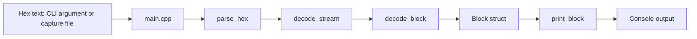
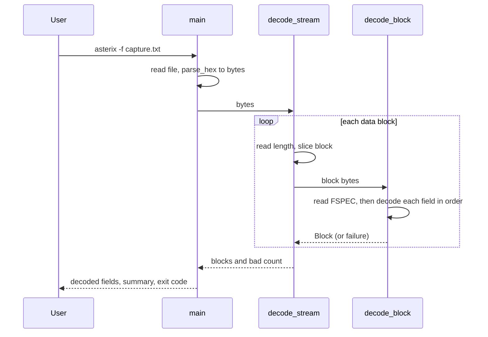
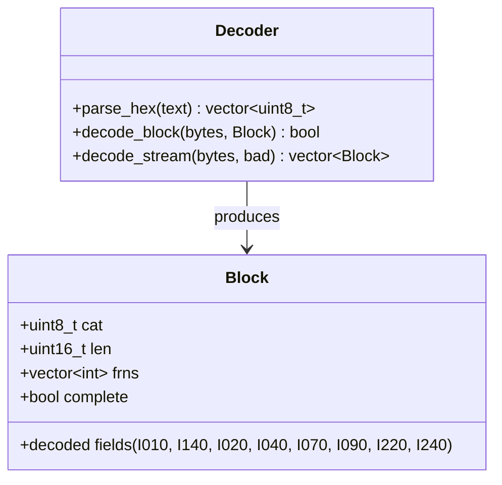

# asterix-decode design

## Data flow

## Decoding sequence

## Key types

## Design decisions
- **Library plus thin CLI.** Decoding lives in `asterix.cpp`; `main.cpp` only handles input and printing, so the decoder can be reused and tested without the CLI.
- **Fields decoded in FRN order.** A field's position depends on the lengths of the fields before it, so decoding stops at the first field not implemented yet and marks the block `complete = false` instead of guessing.
- **Bad data is counted, not fatal.** A truncated or inconsistent block increments a bad counter and the program reports it through its exit code.
- **Stops at a broken length field.** Without a valid length the next block's start is unknown, so the decoder doesn't try to resynchronise.
- **Tests build and run in CI** on every push.